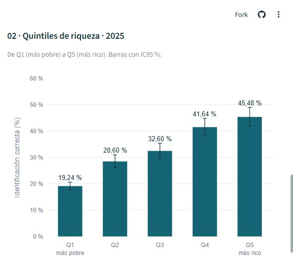
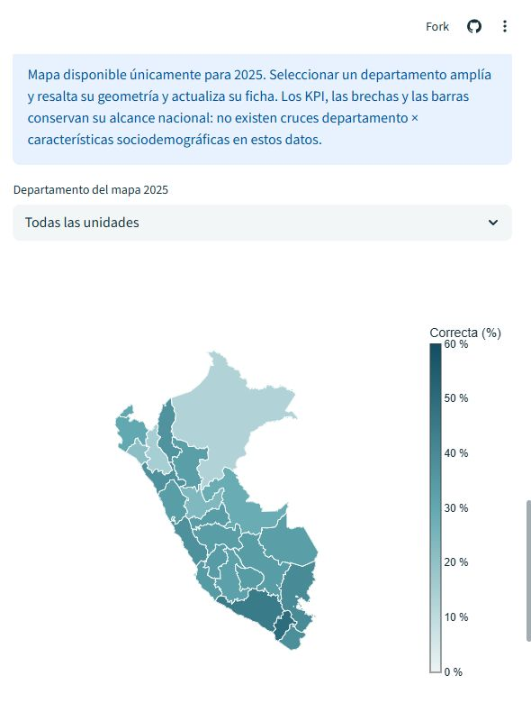

# ¿Quiénes identifican el período fértil en Perú?

**Victor Roman-Lazarte · Tarea 3 · Diplomado de Ciencia de Datos para la Gestión Pública, Pontificia Universidad Católica del Perú (PUCP).**

Dashboard descriptivo de ENDES 2021–2025 desarrollado en Python, Streamlit, pandas y Plotly.
[Enunciado y rúbrica](https://github.com/d2cml-ai/Data-Science-Python/issues/197) ·
[Repositorio](https://github.com/victorroman1998/Python_2).

**Estado al 1 de noviembre de 2026:** aplicación integrada en `main` mediante el
[PR #8](https://github.com/victorroman1998/Python_2/pull/8) y publicada en Streamlit.
**[Abrir el dashboard público](https://python2-fzpvrupsuyq3uwttqkzujx.streamlit.app/).**
El reel revisado de 54 segundos está publicado en [LinkedIn](https://www.linkedin.com/posts/victor-roman-lazarte-a9580817b_cienciadedatos-python-endes-ugcPost-7522834226056941568-PdP3/).
**Entrega registrada:** [comentario en el Issue #197](https://github.com/d2cml-ai/Data-Science-Python/issues/197#issuecomment-6567190143), publicado el 1 de noviembre de 2026.

## Pregunta y cobertura

¿Qué proporción de mujeres de 15–49 años identifica correctamente el período fértil y cómo varía
según características sociodemográficas, económicas y territoriales entre 2021 y 2025?

Cobertura: Perú, hogares particulares, cinco encuestas anuales ENDES. Se incluyen entrevistas
individuales completas de mujeres de 15–49 años con respuesta válida a V217 y datos válidos
de diseño. No se incluyen mujeres de 12–14 años ni se restringe por unión, actividad sexual,
anticoncepción o embarazo. El análisis territorial comprende 24 departamentos y Callao,
exclusivamente en 2025; Lima es el departamento completo, incluida Lima Metropolitana.

## Ejecución y pruebas

Se recomienda **Python 3.12**. Desde la raíz del repositorio:

```bash
python -m venv .venv
# Windows: .venv\Scripts\activate
# Linux/macOS: source .venv/bin/activate
python -m pip install -r tarea_3/requirements.txt
python -m streamlit run tarea_3/app.py
```

La configuración de tema está en `tarea_3/.streamlit/config.toml`, reconocida por la versión
fijada de Streamlit junto al archivo de entrada. Los datos se resuelven con `Path(__file__)`:
también se puede ejecutar desde `tarea_3/` con `python -m streamlit run app.py`.
No se requieren R, credenciales, OneDrive, microdatos, servidores cartográficos ni teselas externas
durante la ejecución. Las dependencias se instalan una sola vez con acceso a PyPI.

```bash
python -m unittest discover -s tarea_3 -p test_dashboard.py -v
```

La suite usa `unittest` y `streamlit.testing.v1.AppTest`, incluidos en Python y Streamlit.
Comprueba regresiones de cifras e IC, checksum del CSV original, estructura de 125 × 28,
cinco años, claves únicas, separación de escenarios y unidades, tamaños muestrales,
categorías y orden, integridad cartográfica y supresión sin reemplazo por cero.
Prueba los tres controles sobre la aplicación real y todas las **130 combinaciones de
5 años × (25 departamentos + todas las unidades)**. Verifica que el año modifica KPI y barras,
la dimensión cambia las series, y el departamento cambia el mapa y la ficha sin alterar los
resultados nacionales. El mapa conserva 2025 en todos los casos.

## Controles y visualizaciones

| Control | Resultado |
|---|---|
| Año, inicial 2025 | Cuatro KPI, barras de riqueza y educación; resalta el año en la serie. |
| Dimensión temporal, inicial área | Nacional, área, riqueza, educación o edad; la referencia nacional permanece. |
| Departamento 2025, inicial todas | Amplía y destaca la geometría y muestra su estimación, IC95 %, n y CV. |

Cuatro visualizaciones: serie anual con banda nacional de IC95 % y barras de error por
categoría; barras de riqueza Q1–Q5; barras horizontales de educación; mapa coroplético de
2025 con escala común 0–60 %. En el mapa, el selector permite acceder a Callao. Los tooltips
incluyen categoría/unidad, año, porcentaje, IC95 %, n sin ponderar y precisión cuando corresponde.

El filtro departamental no modifica los KPI ni los gráficos nacionales, porque no existen cruces
departamento × características en la tabla. El selector de año tampoco cambia el mapa.
No hay filtros combinados inventados ni estimaciones recalculadas. Los valores se muestran con
dos decimales y coma decimal; las cifras originales se conservan completas en el CSV y las figuras.
El CSV original se puede descargar desde la aplicación. Plotly permite ampliar y exportar gráficos
desde su barra de herramientas; la exportación del mapa depende del soporte WebGL del navegador.

## Datos, procedencia y reproducción

**Fuente original:** INEI, Encuesta Demográfica y de Salud Familiar (ENDES).
**Análisis:** elaboración propia del autor; no son estimaciones oficiales del INEI ni resultados
publicados en una revista. La investigación original y la preparación auditada de indicadores
anteceden a esta implementación académica y no se repiten aquí.

Fuentes documentales, consultadas el **1 de noviembre de 2026**:

- [INEI: microdatos, cuestionarios y diccionarios ENDES](https://proyectos.inei.gob.pe/microdatos/Consulta_por_Encuesta.asp).
- [INEI: ENDES 2025](https://www.gob.pe/institucion/inei/informes-publicaciones/8284085-peru-encuesta-demografica-y-de-salud-familiar-endes-2025).
- [Ficha técnica 2025 correcta](https://cdn.www.gob.pe/uploads/document/file/3041581/8604-ficha-tecnica-2025.pdf).
- [Cuestionario individual 2023](https://proyectos.inei.gob.pe/iinei/srienaho/Descarga/DocumentosMetodologicos/2023-5/CuestionarioIndividual.pdf).

`data/indicadores_dashboard.csv` es la copia original recibida, UTF-8 con BOM, coma como
separador y punto decimal. Tiene **125 filas y 28 columnas**; no contiene registros individuales.
SHA256: `f846d14025dbd6929d5e67879c632dbdbdb926f418b378c19b86ae3ab88c3803`.

| Escenario/dimensión | Filas |
|---|---:|
| Principal: nacional | 5 |
| Principal: riqueza | 25 |
| Principal: educación | 20 |
| Principal: edad | 25 |
| Principal: área | 10 |
| Principal: brechas | 10 |
| Sensibilidad nacional sin febrero–marzo | 5 |
| Principal: departamento 2025 | 25 |

Clave única: `(anio, indicador, escenario, dimension, categoria_id)`. La aplicación solo selecciona
filas completas de `escenario="principal"`. Las cinco filas `sin_feb_mar` se preservan para
trazabilidad y descarga, sin mezclarse con las vistas principales.

Las primeras 100 filas proceden de la exportación auditada del libro
`resultados_ENDES_2021_2025.xlsx`, SHA256
`d10a70fb71e23f539ac77a7866c88ed6ef8d35a57b049a54baabbce4c89ff766`.
Para reexportar con acceso al libro original: seleccionar `Prevalencias`, `Brechas` y
`Sensibilidad`; conservar las estimaciones, IC, SE, etiquetas y orden; asignar los escenarios
principal y sin febrero–marzo; mantener `hoja_origen` y `fila_excel_origen` (desde 1).
Las filas de respuesta y los modelos del libro no forman parte del contrato de este dashboard.
Se añaden las 25 estimaciones departamentales auditadas de 2025, identificadas por
`origen="calculo_adicional_departamental_2025"`. El libro y el brief no se publican porque incluyen
referencias privadas; las cifras necesarias y su trazabilidad sí están en el CSV.

El cálculo territorial previo utilizó R 4.5.0 y survey 4.5 sobre REC0111 y RE223132 2025,
sin generar microdatos públicos. Reprodujo nacionalmente 33,6265862 %, SE 0,6816041 pp,
29 452 mujeres, 3 244 UPM, 240 estratos y 3 004 grados de libertad. No se vuelve a ejecutar
ese cálculo. La reproducción pública consiste en cargar los agregados originales, validar el
contrato y generar las vistas. Reexportar desde el libro exige acceso al material del autor;
no es necesario para ejecutar o probar esta entrega.

## Definición y metodología

El desenlace es `1(V217=3)`, respuesta recodificada **«en medio del ciclo»**. La opción de
formulario 04 en la pregunta 238 corresponde a V217=3; no confundir ambas codificaciones ni
agregar un filtro a partir de la pregunta 237. Las respuestas 1, 2, 4, 5, 6 y 8 no se clasifican
como correctas. Solo V217=8 significa «no sabe»; no se interpreta todo el complemento como
desconocimiento. Los valores faltantes se excluyen del denominador y no se convierten en cero.

Los porcentajes y sus IC95 % provienen del análisis original con **diseño de muestreo complejo**:
peso de mujer V005/1 000 000, UPM V021, estrato V022, anidamiento por año, linealización de
Taylor y cuantiles t con grados de libertad del diseño correspondiente. Se conservan
`survey.lonely.psu='adjust'` y `survey.adjust.domain.lonely=TRUE`. La fuente técnica denomina
conglomerado a V001; su igualdad con V021 fue verificada en la preparación de 2025.

Los porcentajes ya están multiplicados por 100. Las brechas Q5–Q1 y urbana–rural se expresan
en **puntos porcentuales** y utilizan sus propios contrastes e IC originales. La aplicación no
promedia porcentajes, reconstruye numeradores con n × porcentaje ni calcula IC restando extremos.
Las restas en las figuras solo convierten límites de IC existentes en longitudes de barras de error.
`n` es el tamaño muestral **sin ponderar**, nunca una estimación de la población peruana.

Educación V149: 0–1 «Sin primaria completa», 2–3 «Primaria completa/secundaria incompleta»,
4 «Secundaria completa», 5 «Alguna superior»; esta última no implica superior completa.
Riqueza: V190 (quintiles 1–5); área: V025; edad: grupos 15–19, 20–24, 25–34, 35–44 y 45–49.
Departamento: V024, códigos de texto **01–25**, conservando ceros iniciales.

La regla editorial de precisión es del proyecto, no un estándar atribuido al INEI:
CV ≤15 % adecuada; 15<CV≤30 % referencial; CV>30 %, n<30 o varianza no estimable: suprimir.
Las brechas se identifican como `contraste_con_ic` y no tienen CV aplicable. Las 125 filas
actuales son publicables. La supresión no reemplaza valores por cero.

## Tres hallazgos de 2025

1. **33,63 %** identificó correctamente el período fértil, IC95 % **32,29–34,96 %**;
   muestra analizada: **29 452** mujeres.
2. Q5: **45,48 %**; Q1: **19,24 %**. Brecha Q5–Q1: **26,24 pp**,
   IC95 % **22,43–30,06 pp**.
3. Urbana: **36,32 %**; rural: **20,95 %**. Brecha urbana–rural: **15,37 pp**,
   IC95 % **13,32–17,41 pp**.

El conocimiento declarado del período fértil **no equivale a identificar individualmente el
momento fisiológico de la ovulación** ni evalúa conocimiento clínico integral. Las cifras
describen grupos; no se interpretan como efectos causales de riqueza, educación o residencia.

## Limitaciones

- En 2021 hay **2 208 faltantes V217** entre 33 179 mujeres elegibles de 15–49 años:
  **6,65 % sin ponderar** y 7,31 % ponderado; 601 en febrero y 1 567 en marzo.
  La muestra principal es 30 971. La sensibilidad excluye febrero y marzo en los cinco años;
  para 2021 pasa de 35,03 % a 35,39 % (IC95 % 34,22–36,57 %). No imputa ni elimina el posible sesgo.
- Los IC heredan el tratamiento de 17–21 estratos con una sola UPM por año después de seleccionar
  la muestra principal; en 2025 son 18. Se conservan los IC originales de cada dominio.
- ENDES rota y retiene parcialmente conglomerados entre años. La serie es descriptiva;
  no se asume independencia entre ediciones ni se anuncian tendencias significativas.
- Las estimaciones territoriales son solo de 2025. El orden de los colores no demuestra
  diferencias estadísticamente significativas entre departamentos.
- No hay cruces entre dimensiones ni estimaciones individuales. No se construyen indicadores
  nuevos mediante agregación de porcentajes.
- Se reutilizan salidas auditadas, sin alegar una reproducción completa y limpia del flujo
  original de R de cinco años, que documentó un código de salida anómalo después de producir
  resultados. El cálculo territorial adicional sí terminó con código 0 según el brief.

## Cartografía y atribución

**INGEMMET / GEOCATMIN**, [capa Departamentos (0)](https://geocatmin.ingemmet.gob.pe/arcgis/rest/services/SERV_CARTOGRAFIA_DEMARCACION_WGS84/MapServer/0),
acceso 01/11/2026. Límites referenciales. Se usa la consulta pública de la capa, con
`outSR=4326` y `f=geojson`; su URL completa, huellas y transformación están en
`data/cartografia_fuente.json`. No se atribuye una licencia específica que la capa no declare;
se conserva atribución institucional y procedencia para este uso académico.

La descarga tiene 32 elementos: se excluyen siete cuerpos de agua `CD_DEPA=99`, quedando
exactamente los códigos únicos 01–25. Unión por `properties.CD_DEPA` y `codigo_departamento`,
ambos como cadenas. `15=LIMA` conserva Lima Metropolitana y el resto; `07=CALLAO` es distinto.

Para mejorar la carga web se aplicó `shapely.coverage_simplify` con tolerancia **0,001 grados**
(del orden de 110 m en latitud, no una precisión catastral). Se conservaron límites compartidos,
topología y todas las partes de los multipolígonos. Cambio relativo máximo de área: **0,0214 %**.
Los 25 resultados son geometrías válidas, no vacías y sin superposiciones de cobertura.
Las pruebas incluyen puntos interiores de Lima Metropolitana, Huacho y Callao.

Reproducir la preparación cartográfica es opcional; no modifica indicadores ENDES:

```bash
python tarea_3/preparar_cartografia.py --source departamentos_original.geojson
# Sin --source, descarga la capa pública; requiere Internet solo para esa preparación.
```

El script verifica la cobertura antes y después, guarda una única copia GeoJSON y su manifiesto.
Para repetir exactamente la misma salida se debe conservar la descarga original cuyo SHA256
figura en el manifiesto; el servicio puede actualizarse. La aplicación nunca lo consulta.

## Dashboard público y despliegue

La configuración es compatible con un archivo de entrada en subdirectorio y dependencias junto
a él. No se modifican `tarea_1/`, `tarea_2/` ni la configuración compartida de la raíz.
Referencias: [organización de archivos](https://docs.streamlit.io/deploy/streamlit-community-cloud/deploy-your-app/file-organization)
y [despliegue](https://docs.streamlit.io/deploy/streamlit-community-cloud/deploy-your-app/deploy).

La aplicación está disponible en
**https://python2-fzpvrupsuyq3uwttqkzujx.streamlit.app/**.
El código definitivo se encuentra en `main`, archivo de entrada `tarea_3/app.py`.
Para reproducir el despliegue en [Streamlit Community Cloud](https://share.streamlit.io/),
conectar `victorroman1998/Python_2`, seleccionar `main` y ese archivo de entrada,
y usar Python 3.12. Las dependencias están en `tarea_3/requirements.txt` y el tema en
`tarea_3/.streamlit/config.toml`. No se necesitan secrets ni microdatos.

Validación de esta entrega: **14 pruebas aprobadas**, incluidas las 130 combinaciones de año y
departamento. Revisión visual en navegador a 1280 × 720 y 390 × 844 píxeles: cuatro gráficos,
etiquetas e IC legibles, mapa real y zoom de Callao; sin desbordamiento horizontal móvil ni
errores en la consola revisada. El enlace público se comprobó durante la preparación audiovisual.

## Reel y comunicación pública

El reel vertical de seis escenas usa capturas reales del dashboard, narración generada con IA
a partir de la voz autorizada del autor, música y subtítulos sincronizados. Incluye los tres
hallazgos de 2025, sus unidades y las limitaciones de interpretación.

- [Guion final de seis escenas](reel/guion_final_reel.md).
- [Captura del gráfico de riqueza de 2025](reel/captura_1_riqueza_2025.jpg).
- [Captura del mapa departamental de 2025](reel/captura_2_mapa_2025.jpg).
- **[Publicación de LinkedIn y reel de 54 segundos](https://www.linkedin.com/posts/victor-roman-lazarte-a9580817b_cienciadedatos-python-endes-ugcPost-7522834226056941568-PdP3/).**





Música: «Cylinder Five», Chris Zabriskie, álbum *Cylinders*,
[CC BY 4.0](https://creativecommons.org/licenses/by/4.0/),
[fuente del autor](https://chriszabriskie.com/cylinders/). Se utilizó un fragmento con fundidos
y volumen reducido. Datos: INEI, ENDES; análisis y visualizaciones: elaboración propia.
Cartografía: INGEMMET / GEOCATMIN, límites referenciales.

La grabación de referencia, los audios de narración, el MP4 y los subtítulos se conservan en
almacenamiento privado fuera del repositorio y de carpetas con enlaces anónimos.
El reel aprobado está disponible públicamente en la publicación de LinkedIn enlazada arriba.

## Archivos

```text
tarea_3/
├── app.py
├── test_dashboard.py
├── preparar_cartografia.py
├── requirements.txt
├── README.md
├── .gitignore
├── .gitattributes
├── .streamlit/config.toml
├── data/
│   ├── indicadores_dashboard.csv
│   ├── peru_departamentos.geojson
│   └── cartografia_fuente.json
└── reel/
    ├── guion_final_reel.md
    ├── captura_1_riqueza_2025.jpg
    └── captura_2_mapa_2025.jpg
```

`.gitattributes` conserva los bytes del CSV y GeoJSON para que sus checksums no cambien
con la conversión automática de finales de línea en Windows.

## Uso de inteligencia artificial

Work asistió en la preparación y auditoría previa del brief y los agregados. Codex asistió en
el código de Streamlit/Plotly, validaciones, pruebas y documentación. No se generaron datos
sintéticos, nuevos modelos ni nuevas estimaciones de encuesta. El autor conserva la
responsabilidad de revisar las cifras, la interpretación, el funcionamiento y la publicación.
La narración del reel se generó localmente con Qwen3-TTS 0.6B Base a partir de una referencia
autorizada de voz propia. Whisper large-v3-turbo verificó las cifras y los tiempos de subtítulos.
El video muestra «Voz generada con IA» y usa gráficos reales del dashboard. El guion y el texto
de LinkedIn se prepararon con asistencia de IA y revisión del autor.
