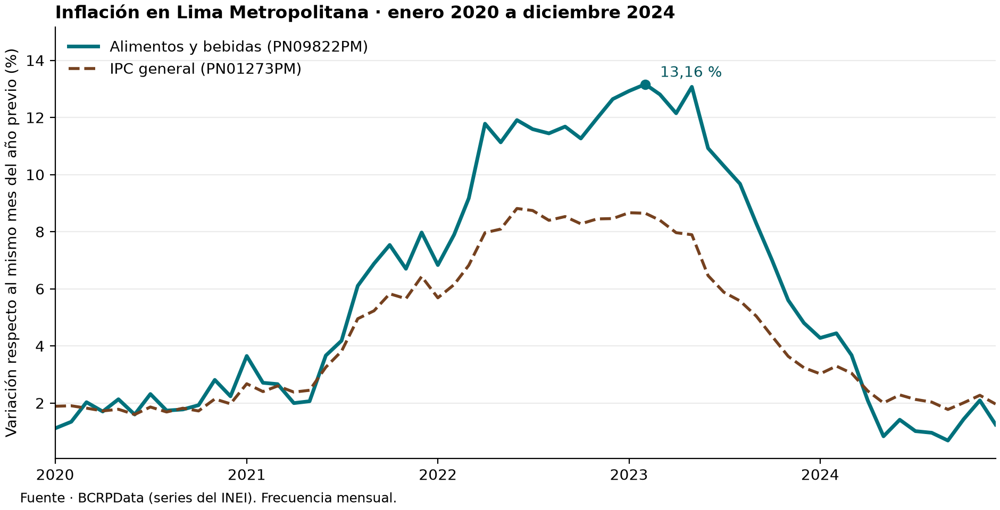
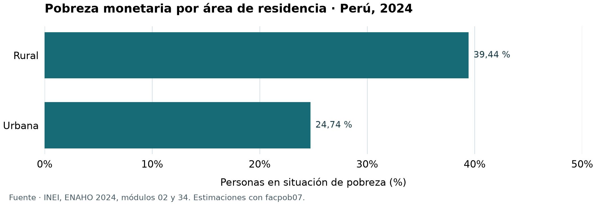
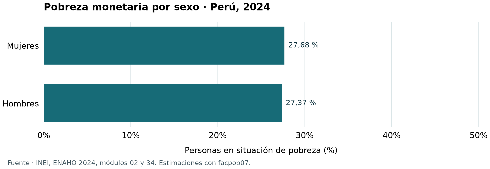
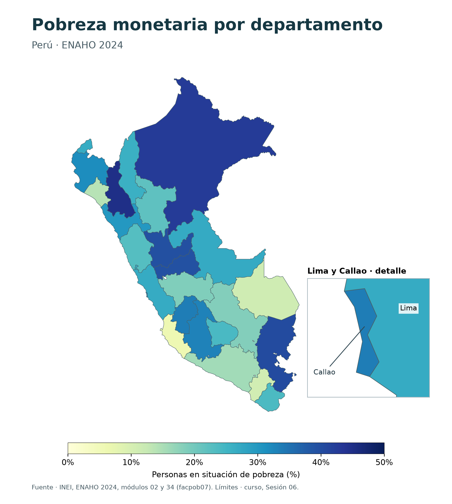

# Inflación de alimentos y pobreza monetaria · Perú, 2020–2024

## Pregunta y objetivo

**¿Cómo evolucionó la inflación de alimentos y bebidas en Lima Metropolitana entre 2020 y 2024, y qué diferencias por área de residencia, sexo y departamento presentó la pobreza monetaria en el Perú en 2024?**

El objetivo es describir cuándo se aceleraron y moderaron los precios de alimentos y bebidas respecto del IPC general, y caracterizar las diferencias en incidencia de pobreza al cierre del periodo de estudio. Los precios de alimentos importan para el poder adquisitivo de los hogares. La cobertura del par de series comparable identificado en el catálogo BCRP delimita el análisis de precios a Lima Metropolitana.

## Fuentes y metodología

**Precios.** BCRPData difunde el IPC del INEI. Se usaron las series de Lima Metropolitana [IPC Alimentos y Bebidas (`$codigo_a`)](https://estadisticas.bcrp.gob.pe/estadisticas/series/mensuales/resultados/$codigo_a/html) e [IPC general (`$codigo_b`)](https://estadisticas.bcrp.gob.pe/estadisticas/series/mensuales/resultados/$codigo_b/html). Ambas contienen 60 observaciones mensuales completas de enero de 2020 a diciembre de 2024. Cada observación mide el cambio porcentual del índice frente al mismo mes del año previo. Se calcularon extremos y medias de las tasas interanuales y se compararon ambas tasas mes a mes en puntos porcentuales (pp). Los cierres de diciembre son variaciones diciembre a diciembre.

**Pobreza.** ENAHO 2024 del INEI. El [módulo 02 de miembros](https://proyectos.inei.gob.pe/iinei/srienaho/descarga/STATA/966-Modulo02.zip) aporta residencia habitual, sexo y `facpob07`. El [módulo 34 de hogares, Sumaria](https://proyectos.inei.gob.pe/iinei/srienaho/descarga/STATA/966-Modulo34.zip) aporta la condición de pobreza. Se normalizaron y comprobaron las llaves y se filtró la residencia según `p204`, `p205` y `p206`. Una unión muchos a uno por conglomerado, vivienda y hogar asignó el estado de pobreza a cada residente. Se consideran pobres las categorías de pobreza extrema y no extrema de Sumaria. El INEI determina esta condición comparando el gasto per cápita del hogar con la línea de pobreza monetaria. [Metodología oficial del INEI](https://www.gob.pe/institucion/inei/informes-publicaciones/6763186-peru-evolucion-de-la-pobreza-monetaria-2015-2024).

La estimación principal divide la suma de `facpob07` de los residentes pobres por la de todos los residentes del ámbito y multiplica por 100. Se eligió porque mantiene la misma unidad individual en todas las comparaciones y permite desagregar por sexo. El área urbana usa estratos 1–5 y la rural 6–8. Los dos primeros dígitos de UBIGEO identifican los departamentos y Callao. Para el contraste, cada hogar de Sumaria representa a sus miembros con `factor07 × mieperho`.

La limpieza comprobó año, llaves únicas, cobertura de la unión, concordancia geográfica, pesos positivos, códigos y recuentos esperados. Contrastó los indicadores nacionales, de área y departamentales con las referencias de la rúbrica y del curso. La unión del mapa por código verificó geometrías válidas y conservó Lima y Callao por separado. [Métodos y tolerancias](../.claude/skills/limpiando-enaho/reference.md) · [Validación](../salidas/validacion.txt).

## Resultados

### Inflación en Lima Metropolitana

La inflación interanual de alimentos y bebidas pasó de **$inicial %** en enero de 2020 a **$final %** en diciembre de 2024. $frase_pico El mínimo fue **$minimo %** en $mes_minimo. Hubo $n_mayor meses con tasas de al menos 10 %, entre $desde_mayor y $hasta_mayor. La media mensual de las tasas interanuales fue $media_a % para alimentos y bebidas y $media_b % para el IPC general. Al cierre de 2024 el IPC general varió $final_general % y la brecha de alimentos y bebidas frente a ese índice fue $brecha_final pp.

| Diciembre de | Alimentos y bebidas (%) | IPC general (%) | Alimentos y bebidas menos general (pp) |
| --- | ---: | ---: | ---: |
$cierres



### Pobreza por área y sexo

La muestra validada contiene **$residentes residentes habituales**. La incidencia nacional estimada fue **$nacional %**. En el área rural alcanzó **$rural %** y en la urbana **$urbana %**. $frase_area Las brechas se calculan antes de redondear las tasas.



La tasa estimada fue **$mujeres %** entre mujeres y **$hombres %** entre hombres. La brecha puntual fue **$brecha_sexo pp**. La clasificación se asigna en el hogar y se desagrega por el sexo registrado de cada residente.



### Heterogeneidad departamental

$frase_depto En $bajo se estimó **$tasa_baja %**. La distancia entre los dos extremos de los $ambitos ámbitos fue **$rango pp**. La tabla presenta los tres valores de cada extremo de la distribución de estimaciones puntuales.

| Ámbito | Incidencia (%) |
| --- | ---: |
$extremos



[Gráfico de barras de los 25 ámbitos](../figuras/pobreza_departamento_2024.png) · [Tabla completa de indicadores](../salidas/indicadores.csv).

## Interpretación

Las tasas de alimentos y bebidas muestran una aceleración marcada en 2022 y comienzos de 2023, con una brecha positiva frente al IPC general al cierre de esos años. En diciembre de 2024 la tasa interanual de alimentos y bebidas seguía siendo positiva y se situaba por debajo de la general. El menor ritmo implica que los precios del rubro seguían creciendo frente a diciembre de 2023.

Las diferencias de pobreza por área y entre los extremos departamentales fueron mayores que la brecha puntual por sexo. Las condiciones locales de empleo, ingresos y acceso a mercados son posibles hipótesis para investigar la heterogeneidad territorial. Evaluarlas requeriría información adicional sobre estos mecanismos y sobre la exposición local a cambios de precios.

## Limitaciones

- ENAHO 2024 se usa como corte transversal anual. Las comparaciones describen grupos en 2024 y no identifican trayectorias de hogares. El informe presenta estimaciones puntuales, sin errores estándar del diseño muestral ni pruebas de significancia para las brechas o el orden departamental.
- El IPC es mensual y agregado para Lima Metropolitana. ENAHO es anual y mide el bienestar de personas a partir del gasto de sus hogares en el Perú. Una tasa interanual de un mes y una tasa de pobreza anual describen escalas temporales y geográficas distintas. El IPC metropolitano solo caracteriza la dinámica de precios de su ámbito.
- El diseño carece de una exposición individual o territorial comparable y de una estrategia de identificación causal. La evolución de los precios y la distribución de la pobreza se analizan por separado.
- La tasa nacional con Sumaria fue $sumaria %, una diferencia de $delta_estimadores pp respecto del estimador principal. El contraste de Sumaria da $sumaria_u % en el área urbana y $sumaria_r % en la rural. Los métodos usan distintos recuentos de miembros por hogar. La [validación](../salidas/validacion.txt) registra sus denominadores, las discrepancias por ámbito y la concordancia de los factores en la unión.

## Reproducción

Desde `tarea_4/` con `uv`, Python 3.12 y HTTPS hacia BCRPData e INEI.

```bash
uv sync --locked --python 3.12
uv run --locked python scripts/investigar.py --desde-cero
uv run --locked pytest -q
```

El coordinador utiliza el servidor de [`.mcp.json`](../.mcp.json) por stdio con el cliente FastMCP. Guarda los argumentos y respuestas de `buscar_series`, `serie`, `resumen` y `comparar_series` en [bcrp_mcp.json](../salidas/bcrp_mcp.json) y alinea las observaciones en el [CSV mensual](../salidas/inflacion_lima_2020_2024.csv). El [catálogo oficial](https://estadisticas.bcrp.gob.pe/estadisticas/series/metadata) contiene las fichas de ambas series.

Las Skills `limpiando-enaho`, `graficando-enaho` y `mapeando-enaho` comparten el lote aprobado. Los insumos se descargan si faltan, según la [guía de ENAHO](../datos/README.md). Para trabajar con insumos ya descargados, añade `--sin-descarga`; BCRPData sigue requiriendo HTTPS. El [plan](plan_investigacion.md), la [verificación de cifras](verificacion_cifras.md), el [JSON de contraste](../salidas/contrastes_fase3.json) y la [evidencia de integración](../evidencias_ia/integracion/README.md) documentan los pasos y resultados.
